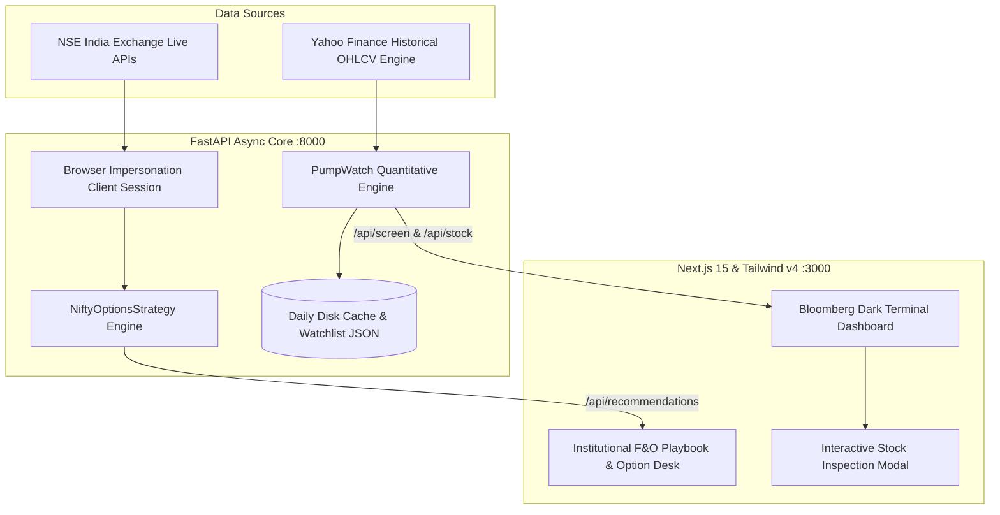
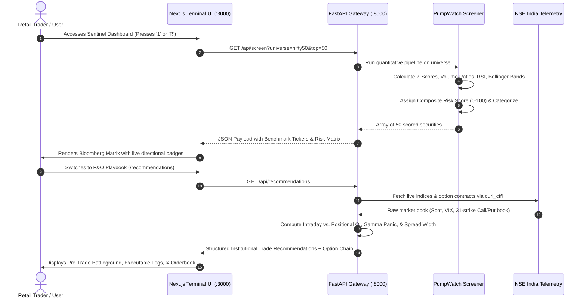

# SentinelMarket: Real-Time Equity Anomaly Surveillance & Institutional Derivatives Playbook

[](https://fastapi.tiangolo.com/)
[](https://nextjs.org/)
[](https://tailwindcss.com/)
[](https://python.org)
[](LICENSE)

---

## 📌 Executive Summary

### 1. Why Does This Project Exist?
In modern retail capital markets—especially across emerging exchange ecosystems like the **National Stock Exchange of India (NSE)** and **Bombay Stock Exchange (BSE)**—retail investors are increasingly subjected to coordinated market manipulation schemes commonly termed **"Pump-and-Dump" (P&D)**.

Organized syndicated cartels, unauthorized Telegram "tip channels", and influencer-led momentum groups artificially inflate the price and volume of micro-cap, small-cap, or thinly traded securities through circular trading, wash sales, and fraudulent hype. Once retail buyers enter at inflated prices under Fear-Of-Missing-Out (FOMO), the manipulators dump their positions, inducing catastrophic liquidity dry-ups and capital destruction for retail participants.

Simultaneously, retail derivative traders face severe statistical disadvantages in index options (e.g., NIFTY 50 and BANK NIFTY) because they lack institutional visibility into **Open Interest (OI) concentration**, **trapped option writer unwinding**, and **implied volatility (IV) regimes**.

**SentinelMarket** was architected to bridge this asymmetry. It operates as an institutional-grade, zero-latency surveillance terminal and derivatives execution engine, empowering retail traders with real-time quantitative safety scoring, anomaly diagnostics, and rule-based option strategies.

---

## 🎯 What Does the System Do?

SentinelMarket delivers two core financial intelligence capabilities:

1. **Real-Time Equities Surveillance Engine (`PumpWatch`):**
   - Ingests real-time tick and daily OHLCV market feeds across 50+ benchmark and user-selected equities.
   - Computes multi-factor quantitative anomaly metrics: **Volume Ratio (rolling median)**, **Volume Z-Score ($\sigma$-standardization)**, **14-period RSI Divergence**, and **Bollinger Band Outliers**.
   - Generates a composite **Manipulation Risk Score (0–100)** categorized via a deterministic traffic-light risk tier:
     - 🟢 **LOW (0–20):** Institutional clean flow, safe liquidity.
     - 🟡 **MEDIUM (21–40):** Active momentum, elevated volatility.
     - 🟠 **HIGH (41–60):** Significant volume spikes without underlying corporate news.
     - 🟣 **EXTREME (61–100):** Suspected pump-and-dump scheme; circuit limit and illiquid trap probability.

2. **Institutional F&O Playbook & 31-Strike Option Chain Desk:**
   - Evaluates live **NIFTY 50** & **BANK NIFTY** derivatives contracts directly sourced via official exchange telemetry.
   - Computes **Intraday OI Momentum** (fast Put/Call writing shifts) vs. **Positional Expiry Walls** (cumulative monthly support/resistance).
   - Flags **Step A: Trapped Writer Panic Unwinding** (where short sellers are squeezed, creating violent gamma moves).
   - Enforces a **Strike Spread Width Filter** (~1.65% spot threshold) to systematically differentiate between high-probability directional trends and sideways chop.
   - Renders a complete **31-strike live option chain orderbook matrix** with Call (CE) vs. Put (PE) In-The-Money (ITM) highlighting, At-The-Money (ATM) anchoring, and Max Pain calculations.

---

## 🔬 How Does It Work? Quantitative Methodology

### 1. Volume Z-Score Metric
To isolate volume anomalies independent of general market growth, SentinelMarket calculates a rolling $N$-day ($N=20$) standardized Volume Z-Score:

$$\mu_V = \frac{1}{N}\sum_{i=1}^{N} V_{t-i}, \quad \sigma_V = \sqrt{\frac{1}{N}\sum_{i=1}^{N}(V_{t-i} - \mu_V)^2}$$

$$Z_V = \frac{V_t - \mu_V}{\sigma_V}$$

Where $V_t$ is the current trading day's cumulative volume. A $Z_V > 3.0$ triggers immediate anomaly alerts.

### 2. Relative Strength Index (RSI) Overbought Momentum
Standard Wilder's 14-period RSI monitors rapid price acceleration:

$$RS = \frac{\text{EMA}_{14}(\text{Upward Gains})}{\text{EMA}_{14}(\text{Downward Losses})}, \quad \text{RSI} = 100 - \left(\frac{100}{1 + RS}\right)$$

Stocks with $\text{RSI} > 75$ coupled with $Z_V > 2.5$ receive compounding risk penalties.

### 3. Bollinger Band Outliers
Measures statistical dispersion from the 20-day Simple Moving Average (SMA):

$$\text{Upper Band} = \text{SMA}_{20}(P) + 2 \cdot \sigma_P$$

Breaches above the Upper Band in illiquid counters heavily weight the final composite risk score.

### 4. Option Chain Trapped Writer Algorithm
In derivatives markets, aggressive unwinding by option writers provides the highest probability leading indicator:

$$\Delta \text{OI}_{\text{PE}} = \text{Change in Put Open Interest at Key Strike}$$
$$\Delta \text{OI}_{\text{CE}} = \text{Change in Call Open Interest at Key Strike}$$

When $\Delta \text{OI} < -15\%$ on an intraday basis accompanied by underlying spot breaching that strike, SentinelMarket triggers a **Gamma Panic Unwinding Override**, advising directional entry (Bull Call Spread / Bear Put Spread) rather than passive credit selling.

---

## 🏛 System Architecture & Design

SentinelMarket is designed as a decoupled, high-performance client-server architecture:



---

## 🔄 End-to-End Operational Workflow

The following sequence details how an end-to-end surveillance scan and recommendation run executes:



---

## 📂 Repository File Structure

```
stock-pump-and-dump/
├── pumpwatch/                  # Core mathematical surveillance module
│   ├── __init__.py
│   ├── config.py              # Tunable thresholds (Z-scores, RSI limits, weights)
│   ├── data.py                # Data ingestion layer + caching
│   ├── signals.py             # Pure mathematical functions (RSI, Bollinger, Z-score)
│   ├── scoring.py             # 0-100 composite risk scoring engine
│   ├── screen.py              # Batch execution pipeline across stock lists
│   ├── cli.py                 # Standalone terminal CLI runner
│   ├── tickers.txt            # Monitored securities list
│   └── tests/                 # 19 automated unit tests
│
├── backend/                    # FastAPI web server
│   ├── main.py                # REST endpoints (/api/screen, /api/stock, /api/recommendations)
│   ├── nifty_options_strategy.py # Institutional OI derivatives matrix & NSE parser
│   ├── requirements.txt       # Python dependencies (FastAPI, uvicorn, curl_cffi, pandas)
│   └── tests/                 # Automated API integration tests
│
├── frontend/                   # Bloomberg Dark Terminal (Next.js 15 + Tailwind CSS v4)
│   ├── src/app/
│   │   ├── page.tsx           # Terminal Surveillance Dashboard (Table, Tickers, Hotkeys)
│   │   ├── recommendations/
│   │   │   └── page.tsx       # F&O Options Desk & 31-Strike Option Chain Orderbook
│   │   ├── components/        # Detail inspection modals, charts, watchlist managers
│   │   ├── globals.css        # Pure carbon theme, typography scaling & animations
│   │   └── layout.tsx         # Root dark layout wrapper
│   ├── package.json
│   └── tsconfig.json
│
├── dev.ps1                     # One-click Windows PowerShell startup script
└── README.md                   # Technical documentation & research manifesto
```

---

## 📚 Academic Literature & Research Gap Analysis

### 1. Academic Reference Papers

1. **Nam, K. & Skillicorn, D. (IEEE / arXiv)**  
   *Paper:* *"Detecting Pump & Dump Stock Market Manipulation from Online Forums"*  
   *Focus:* Utilizing Natural Language Processing (NLP) across social platforms to predict manipulation events prior to breakout.  
   *Link:* [arXiv:2104.09340](https://arxiv.org/abs/2104.09340)

2. **Li, T., Shin, D., & Wang, X. (SSRN Electronic Journal)**  
   *Paper:* *"Cryptocurrency Pump-and-Dump Schemes: An Empirical and Machine Learning Analysis"*  
   *Focus:* Statistical analysis of volume anomalies, liquidity drains, and post-dump asset recovery dynamics in decentralized markets.  
   *Link:* [SSRN:3267075](https://papers.ssrn.com/sol3/papers.cfm?abstract_id=3267075)

3. **Massimo, L. M., et al. (ACM Transactions on the Web)**  
   *Paper:* *"Pump-and-Dumps in Financial Markets: Anatomy and Detection Strategies"*  
   *Focus:* Analyzing transaction graphs and order-book depth depletion during deliberate market manipulation attacks.  
   *Link:* [Massimo et al. Research Index](https://massimolamorgia.com/)

---

### 2. Identifying the Research Gap

| Dimension | Existing Academic Research | SentinelMarket Approach |
| :--- | :--- | :--- |
| **Data Recency** | Primarily **post-mortem** (analyzing manipulation events days or weeks after completion using historical datasets). | **Live In-Flight Streaming:** Operates in real-time ($t=0$) during trading hours with sub-minute execution cycles. |
| **Execution Domain** | Focused heavily on un-regulated cryptocurrencies or isolated small-cap US OTC penny stocks. | Focused on **National Stock Exchange of India (NSE)**, operating within SEBI circuit-filter limits and auction-market rules. |
| **Retail Usability** | Complex offline Jupyter notebooks, opaque black-box deep learning weights, or theoretical graph neural networks. | **Actionable Terminal UI:** Color-coded traffic lights, exact volume ratios, human-readable rationale, and keyboard hotkeys. |
| **Derivatives Integration** | Completely ignores derivative options markets and Open Interest dynamics when studying manipulation. | **Cross-Asset Synthesis:** Simultaneously scans underlying equities while calculating index option chain writer panic and gamma unwinding. |

#### Specific Research Gap Addressed:
*Academic models almost universally treat volume spikes as purely statistical time-series anomalies without factoring in structural orderbook liquidity barriers (such as daily turnover in Crores) or concurrent institutional options positioning.* 

SentinelMarket closes this gap by cross-referencing **historical standard deviation ($Z_V$)** with **absolute turnover thresholds**, ensuring that genuine institutional accumulation in blue-chip equities is never misclassified as a fraudulent pump-and-dump scheme.

---

## ⚡ Quickstart & Installation

### 1. Prerequisites
- **Python:** Version 3.11 or newer
- **Node.js:** Version 18.x or newer & npm
- **Operating System:** Windows, macOS, or Linux

### 2. Clone the Repository
```bash
git clone https://github.com/thakurcoder/stock-pump-and-dump.git
cd stock-pump-and-dump
```

### 3. Setup Python Backend Environment
```bash
# Create Python virtual environment
python -m venv pumpwatch/venv

# Activate virtual environment (Windows PowerShell)
.\pumpwatch\venv\Scripts\Activate.ps1

# Install pumpwatch in editable mode
pip install -e pumpwatch

# Install backend dependencies
pip install -r backend/requirements.txt
```

### 4. Setup Frontend Dependencies
```bash
cd frontend
npm install
cd ..
```

### 5. Launch Application

**Option A — Automated One-Click Script (Windows PowerShell):**
```powershell
.\dev.ps1
```

**Option B — Manual Launch:**
```bash
# Terminal 1: Backend API
.\pumpwatch\venv\Scripts\python.exe -m uvicorn backend.main:app --host 0.0.0.0 --port 8000 --reload

# Terminal 2: Frontend Terminal UI
cd frontend
npm run start   # Or 'npm run dev' for development mode
```

- **Frontend Interface:** [http://localhost:3000](http://localhost:3000)
- **F&O Recommendations Desk:** [http://localhost:3000/recommendations](http://localhost:3000/recommendations)
- **FastAPI OpenAPI Interactive Docs:** [http://localhost:8000/docs](http://localhost:8000/docs)

---

## ⌨️ Terminal Keyboard Shortcuts

The Bloomberg Terminal interface supports keyboard navigation for speed:
- <kbd>1</kbd> — Switch active universe to **NIFTY 50**
- <kbd>2</kbd> — Switch active universe to **Custom Watchlist**
- <kbd>R</kbd> — Trigger immediate live data refresh
- <kbd>/</kbd> — Focus the ticker search command line

---

## 🛡 Disclaimer
*This software is developed strictly for quantitative research, algorithmic surveillance, and educational purposes. It does not constitute financial, investment, or legal advice. Market participants must perform independent due diligence and consult SEBI-registered financial advisors prior to entering capital market positions.*
